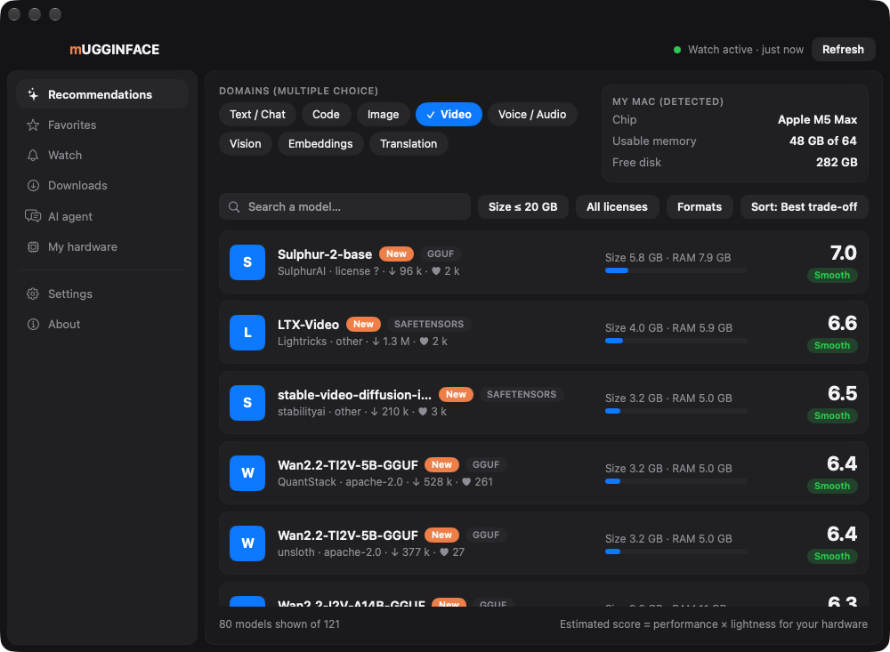

# mUGGINFACE

## About
mUGGINFACE is a native macOS app (part of the DESKTOP MAC TOOLKIT) that lists the best Hugging Face AI models for your Mac, with constant monitoring. Pick your domains (text, code, image, video, voice, vision, embeddings, translation); the app detects your chip, memory and disk, scores each model by estimated performance and lightness, and warns when a model is too heavy. It can download a model itself (resume, SHA-256 check) or send the install instructions to an AI agent (Claude Code, Claude API, or a custom command). An Audit pane compares the models installed on your Mac with the best candidates, tracks the evolution day by day, lets an AI agent write the analysis and advice, and can run a reversible update plan (backups, journal, one-click rollback). Languages: French, English, Spanish, Italian. Authors: Starbudweiser & Claude Code (Anthropic). MIT License, © 2026 Starbudweiser; provided as is, without warranty.

## Usage
- Run `./build_app.sh` (installs into `~/Applications/Applications Personnelles`); `DEV=1 ./build_app.sh` builds the development version (`fr.stephan.mugginface.dev`, separate data).
- Mockups: `maquettes/`. Architecture: `ARCHITECTURE.md`. Documentation: `docs/FONCTIONNALITES.md`, `docs/mUGGINFACE-Developpement.pdf`, `docs/mUGGINFACE-Maquettage.pdf`.
- Scores are estimates (size, popularity, trend, freshness), not official benchmarks.

## Français

### Utilisation
- Lancer `./build_app.sh` (installe dans `~/Applications/Applications Personnelles`) ; `DEV=1 ./build_app.sh` construit la version de développement (`fr.stephan.mugginface.dev`, données séparées).
- Maquettes : `maquettes/`. Architecture : `ARCHITECTURE.md`. Documentation : `docs/FONCTIONNALITES.md`, `docs/mUGGINFACE-Developpement.pdf`, `docs/mUGGINFACE-Maquettage.pdf`.
- Les scores sont des estimations (taille, popularité, tendance, fraîcheur), pas des benchmarks officiels.

## Support / Soutenir

This app is free. If it is useful to you, you can support the project (optional, no reward expected): [GitHub Sponsors](https://github.com/sponsors/starbudweiser).

Cette appli est gratuite. Si elle vous est utile, vous pouvez soutenir le projet (facultatif, sans contrepartie) : [GitHub Sponsors](https://github.com/sponsors/starbudweiser).
